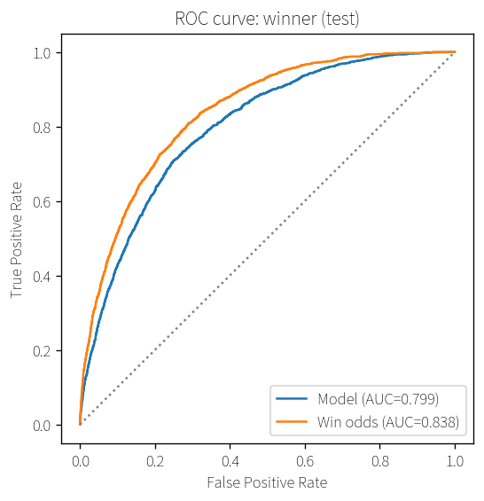

# 適用中のモデル: v20261128_173306

`scripts/model_registry.py` が, モデルを適用するたびに書き直すファイル (手で編集しない).

| 項目 | 内容 |
|---|---|
| 学習した日時 | 2026-11-28T17:33:06+09:00 |
| 学習期間 | 2024-01-06〜2026-11-22 (9997 レース) |
| テスト期間 | 2026-05-02〜2026-11-22 |
| 適用した日時 | 2026-11-28 17:34:54 |

## テスト期間の精度

単勝オッズ = 確定単勝オッズから逆算した確率で予想した場合 (比較用. オッズはレース後に確定する値なので, モデルの特徴量には使っていない).

| 指標 | モデル | 単勝オッズ |
|---|---:|---:|
| ROC-AUC (1 着か否か) | 0.7987 | 0.8382 |
| ROC-AUC (レースごとの平均) | 0.7807 | 0.8200 |
| logloss (レース単位. 小さいほど良い) | 2.0787 | 1.9020 |
| 予測 1 位の馬が 1 着だった割合 | 0.283 | 0.348 |
| 予測上位 3 頭のうち 3 着以内だった割合 | 0.485 | 0.528 |
| 予測上位 2 頭のワイドが的中した割合 | 0.268 | 0.332 |

## ROC 曲線 (テスト期間)

その他: `summary.json` (評価指標・最良パラメータ), `calibration.csv` (予測確率帯ごとの実際の 1 着率),
`feature_importance.csv` (特徴量の重要度).
