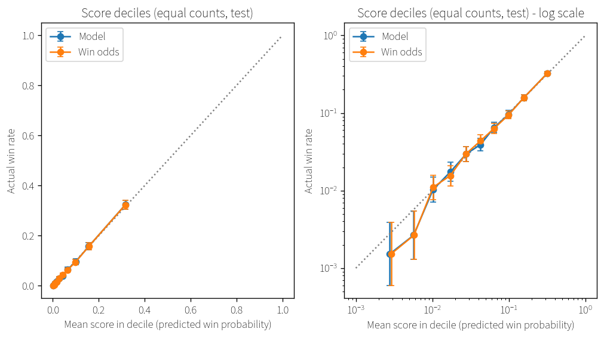

# 適用中のモデル: v20261128_222424

`scripts/model_registry.py` が, モデルを適用するたびに書き直すファイル (手で編集しない).

| 項目 | 内容 |
|---|---|
| 学習した日時 | 2026-11-28T22:24:24+09:00 |
| 学習期間 | 2024-01-06〜2026-11-28 (10045 レース) |
| テスト期間 | 2026-05-09〜2026-11-28 |
| モデルの種類 | 単勝オッズとの差を学習 (推論に発走前の単勝オッズを使う) |
| 適用した日時 | 2026-11-28 22:26:15 |

## メインの目標: モデルを混ぜると, オッズ単体より当たるか (テスト期間)

各馬のスコア = a × log(モデルの確率) + b × log(オッズの確率) で混ぜ, オッズ単体 (そのままと補正後の良い方) と比べる.
テスト期間を前半・後半に分け, 混ぜ方を決めていない方のレースで評価. 混ぜた予測かモデル単体の logloss の改善の
95% 信頼区間が 0 より上なら目標達成 (オッズとの差を学習したモデルは, モデル単体がすでにオッズと混ざった予測).

**判定: 目標未達: オッズよりわずかに良いが, 偶然の範囲を出ない**

| 項目 | オッズ単体 | 混ぜた予測 | モデル単体 |
|---|---:|---:|---:|
| logloss (小さいほど当たる) | 1.9014 | 1.9052 | 1.9005 |
| 1 着的中率 | 34.9% | 35.3% | 35.0% |

| 項目 | 値 |
|---|---:|
| レース数 | 1954 |
| logloss の改善 (オッズ単体 - 混ぜた予測) | -0.0038 (95% 信頼区間 -0.0079 〜 0.0003) |
| logloss の改善 (オッズ単体 - モデル単体) | 0.0009 (95% 信頼区間 -0.0036 〜 0.0055) |
| 混ぜ方の重み (モデル / オッズ) | 0.659 / 0.383 |
| モデルの重みが 0 より大きいかの p 値 | 0.003 |
| 期待値 > 1.0 の馬の単勝 (頭数 / 回収率) | 233 / 101.2% |

## テスト期間の精度

単勝オッズ = 確定単勝オッズから逆算した確率で予想した場合 (比較用).

| 指標 | モデル | 単勝オッズ |
|---|---:|---:|
| ROC-AUC (1 着か否か) | 0.8385 | 0.8384 |
| ROC-AUC (レースごとの平均) | 0.8195 | 0.8199 |
| logloss (レース単位. 小さいほど良い) | 1.9005 | 1.9016 |
| 予測 1 位の馬が 1 着だった割合 (単勝オッズの列は 1 番人気) | 0.350 | 0.348 |
| 予測上位 3 頭のうち 3 着以内だった割合 | 0.528 | 0.528 |
| 予測上位 2 頭のワイドが的中した割合 | 0.332 | 0.334 |

## 予測 1 位の馬 vs 1 番人気の馬 (テスト期間)

モデルのスコアがトップの馬と, 単勝オッズが一番低い馬 (1 番人気) が 1 着になった割合の比較.

| 項目 | 値 |
|---|---:|
| レース数 | 1954 |
| 予測 1 位の馬が 1 着 | 35.0% |
| 1 番人気の馬が 1 着 | 34.9% |
| 差 (予測 1 位 - 1 番人気) | +0.1% (95% 信頼区間 -0.7% 〜 +0.9%) |
| p 値 (マクネマー検定) | 0.905 |
| 判定 | 差があるとは言えない |
| 予測 1 位と 1 番人気が同じ馬だった割合 | 93.0% |
| 違う馬だったレースでの 1 着率 (予測 1 位 / 1 番人気) | 26.3% / 24.8% |

各レースで単勝を 100 円ずつ買った場合 (賭け金の合計 195,400 円. 払戻は確定した単勝オッズ x 100 円):

| 賭けた馬 | 総利益 | 回収率 |
|---|---:|---:|
| 予測 1 位の馬 | -35,580 円 | 81.8% |
| 1 番人気の馬 | -36,650 円 | 81.2% |
| 差 (予測 1 位 - 1 番人気) | +1,070 円 | +0.5% (95% 信頼区間 -2.4% 〜 +3.5%) |

## スコアと実際の 1 着率のずれ (テスト期間)

スコアの低い順に並べ, 頭数が同じになるように 10 等分 (1 = 最も低い 10%. 単勝オッズはそれ自身の順で 10 等分). 差 = 実際の 1 着率 - スコアの平均 (プラス = 過小評価, マイナス = 過大評価).
ECE = 帯ごとの |差| を頭数で重み付けした平均 (小さいほど良い).

ECE: モデル 0.0023 / 単勝オッズ 0.0024 (スコアの平均が 1 着率の 95% 信頼区間の外にある帯: モデル 1 個 / 単勝オッズ 1 個)

| 帯 | スコアの範囲 | 頭数 | スコアの平均 | 実際の 1 着率 | 差 | 1 着率の 95% 信頼区間 | オッズの範囲 | オッズの平均 | 実際の 1 着率 (オッズ) | 差 (オッズ) |
|---|---|---:|---:|---:|---:|---:|---|---:|---:|---:|
| 1 | 0.1%〜0.4% | 2,631 | 0.3% | 0.2% | -0.1% | 0.1%〜0.4% | 0.1%〜0.4% | 0.3% | 0.2% | -0.1% |
| 2 | 0.4%〜0.8% | 2,631 | 0.6% | 0.3% | -0.3% | 0.1%〜0.5% | 0.4%〜0.8% | 0.6% | 0.3% | -0.3% |
| 3 | 0.8%〜1.3% | 2,631 | 1.0% | 1.0% | +0.0% | 0.7%〜1.5% | 0.8%〜1.3% | 1.0% | 1.1% | +0.1% |
| 4 | 1.3%〜2.2% | 2,631 | 1.7% | 1.7% | +0.0% | 1.3%〜2.3% | 1.3%〜2.2% | 1.7% | 1.6% | -0.2% |
| 5 | 2.2%〜3.4% | 2,630 | 2.8% | 3.0% | +0.2% | 2.4%〜3.7% | 2.2%〜3.4% | 2.7% | 3.0% | +0.2% |
| 6 | 3.4%〜5.2% | 2,631 | 4.3% | 3.9% | -0.4% | 3.2%〜4.7% | 3.4%〜5.2% | 4.3% | 4.4% | +0.1% |
| 7 | 5.2%〜8.0% | 2,631 | 6.4% | 6.5% | +0.1% | 5.7%〜7.5% | 5.2%〜8.0% | 6.4% | 6.3% | -0.1% |
| 8 | 8.0%〜12.2% | 2,631 | 9.9% | 9.6% | -0.3% | 8.5%〜10.8% | 8.0%〜12.3% | 9.9% | 9.5% | -0.5% |
| 9 | 12.2%〜20.2% | 2,631 | 15.7% | 15.7% | +0.1% | 14.4%〜17.2% | 12.3%〜20.3% | 15.7% | 15.8% | +0.1% |
| 10 | 20.2%〜81.5% | 2,630 | 31.6% | 32.4% | +0.8% | 30.6%〜34.2% | 20.3%〜79.6% | 31.6% | 32.4% | +0.7% |

## 3 着以内のモデル (テスト期間)

各馬が 3 着以内に入る確率を予測するモデル. 推論では 1 着のモデルと併用して着順をシミュレーションする.
単勝オッズ = 単勝オッズから逆算した 1 着の確率で Harville モデルを使って計算した 3 着以内の確率.

| 指標 | モデル | 単勝オッズ |
|---|---:|---:|
| ROC-AUC (3 着以内か否か) | 0.8165 | 0.8157 |
| ROC-AUC (レースごとの平均) | 0.7977 | 0.7973 |
| logloss (各馬の二値. 小さいほど良い) | 0.4109 | 0.4150 |
| 予測 1 位の馬が 3 着以内だった割合 (複勝の的中率) | 0.663 | 0.669 |
| 予測上位 3 頭のうち 3 着以内だった割合 | 0.530 | 0.528 |
| レースごとの確率の合計の平均 (3 に近いほど良い) | 2.976 | 3.000 |

オッズとの比較 (各馬の二値の logloss をレースごとに合計): 改善 0.0552 (95% 信頼区間 0.0401 〜 0.0719) → **オッズより当たる**

スコアと実際の 3 着以内率のずれ (10 等分): ECE モデル 0.0139 / 単勝オッズ 0.0270

着順のシミュレーションの当たり具合 (1 着のモデルだけ / 3 着以内のモデルも併用. logloss は小さいほど良い):

| 指標 | 1 着のモデルだけ | 併用 |
|---|---:|---:|
| 3 着以内の logloss (レースごとの合計) | 5.5910 | 5.5152 |
| ワイドの確率が最も高い組の的中率 | 33.4% | 33.1% |
| 3 連複の logloss | 4.3117 | 4.2684 |
| 3 連単の logloss | 5.8066 | 5.8088 |

## ROC 曲線 (テスト期間)

その他: `summary.json` (評価指標・最良パラメータ), `calibration.csv` (予測確率帯ごとの実際の 1 着率),
`feature_importance.csv` (特徴量の重要度).
